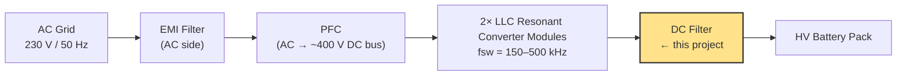
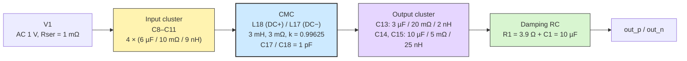
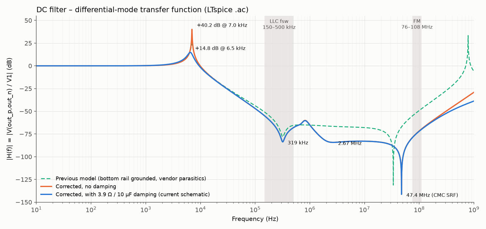

# DC-Side EMI Filter for an OBC (`0025_dc_filter`)

Differential-mode (DM) model of the DC output filter of an EV On-Board Charger, placed after a dual-module LLC stage and before the HV battery. The filter is modelled in LTspice (AC sweep) and PLECS.



The two LLC modules switch at **150–500 kHz**. After rectification the DC bus still carries switching ripple and its harmonics (DM), plus common-mode (CM) noise coupled through parasitic capacitances to chassis. Both must be attenuated to meet the automotive conducted-emissions standard **CISPR 25** (150 kHz – 108 MHz).

## Project structure

```
0025_dc_filter/
├── simulations/
│   ├── dc_filter.asc      # LTspice schematic (AC sweep + .meas results)
│   └── dc_filter.plecs    # PLECS model of the same filter (see note below)
└── docs/
    ├── bode.png           # |H(f)| from the LTspice model
    └── plecs_schematic.png
```

LTspice outputs (`*.raw`, `*.log`, `*.net`, …) are written next to the schematic and are not tracked in git. Run the simulation to regenerate them. The `.meas` results (peak, attenuation at 150 k / 300 k / 500 k / 108 MHz) are printed in `dc_filter.log`.

## Circuit



- DC+ (top) and DC− (bottom) form one differential pair. Only the input side of DC− is grounded (the SPICE reference); the output side (`out_n`) is a separate node.
- Every capacitor cell is a shunt X-cell (C + ESR + ESL) across the pair.
- The only series element is the CMC: L18 in DC+ and L17 in DC−, both with their dot on the output side, so DM current cancels the core flux.
- The plotted quantity is `H(f) = V(out_p, out_n) / V1`. With `AC 1` this equals `V(out_p,out_n)` directly.

### Component values

| Block | Ref. | C | ESR | ESL / L | SRF |
|---|---|---|---|---|---|
| Input cluster | C8–C11 (R9–R12, L8–L11) | 6 µF each | 10 mΩ | 9 nH | 685 kHz |
| CMC winding | L18, L17 | — | 3 mΩ | 3 mH | — |
| CMC parasitic | C17, C18 | 1 pF | — | — | 47.5 MHz (with DM leakage) |
| Output cell | C13 (R13, L13) | 3 µF | 20 mΩ | 2 nH | 2.05 MHz |
| Output cell | C14 (R14, L14) | 10 µF | 5 mΩ | 25 nH | 318 kHz |
| Output cell | C15 (R2, L15) | 10 µF | 5 mΩ | 25 nH | 318 kHz |
| Damping | R1, C1 | 10 µF | 3.9 Ω | — | — |

All parts are ideal elements; the ESR and ESL are drawn as explicit R and L so that every parasitic in the model is visible on the schematic.

## How the filter works

### Common-mode choke

| Current type | Core flux | Impedance seen |
|---|---|---|
| Differential (equal and opposite on DC+ / DC−: the charging current and ripple) | Cancels | Low: leakage inductance only |
| Common-mode (same direction on both conductors, returning via chassis) | Adds | High: full self-inductance |

```
M          = k · L               = 0.99625 · 3 mH       = 2.989 mH
L_leak(DM) = 2 · L · (1 − k)     = 2 · 3 mH · 0.00375   = 22.5 µH
R(DM)      = 2 · 3 mΩ                                    = 6 mΩ
```

The residual leakage inductance gives a "free" DM filter pole without a separate DM choke. C17 and C18 model the inter-winding capacitance of each winding. With each winding's 11.25 µH share of the leakage, they set the CMC's self-resonance:

```
f_SRF(CMC) = 1 / (2π · √(11.25 µH · 1 pF)) ≈ 47.5 MHz
```

Above this frequency the choke is capacitive and stops blocking.

### Capacitor banks

A real capacitor is `Z = ESR + jωL + 1/(jωC)`. It is capacitive below its SRF, has its minimum impedance (= ESR) at the SRF, and is inductive above it. N identical cells in parallel keep the same SRF (`L/N · N·C = L·C`).

- **C14 ∥ C15**: 20 µF, 2.5 mΩ, 12.5 nH → SRF ≈ 318 kHz, centred in the LLC band.
- **C13**: 3 µF, 20 mΩ, 2 nH → SRF ≈ 2.05 MHz.
- **Total output capacitance**: 3 + 10 + 10 = 23 µF.

The **input cluster has no effect on `H(f)`** in this test, because it sits directly across a near-ideal source (1 mΩ). It still matters in hardware: it handles the ripple current at the LLC output, which a voltage-source AC sweep cannot show (that needs a current-source excitation with a realistic source impedance).

### Damping network

The CMC leakage inductance and the output capacitance form a series LC resonance:

```
f0 = 1 / (2π · √(22.5 µH · 23 µF)) ≈ 7.0 kHz
Z0 = √(22.5 µH / 23 µF)            ≈ 1.0 Ω
```

Undamped, this peaks at **+40 dB**. A parallel R–C damping leg (Middlebrook) across the **output** with `Cd = 10 µF` (n = Cd/C ≈ 0.43) has an optimum near `Rd ≈ 3.9 Ω`:

| Rd (across output, Cd = 10 µF) | Peak |
|---|---|
| none | +40.2 dB @ 7.0 kHz |
| 10 Ω | +19.8 dB |
| **3.9 Ω** | **+14.8 dB @ 6.5 kHz** |
| 2.2 Ω | +15.0 dB |
| 1.3 Ω | +17.4 dB |

To lower the peak further, increase Cd. The damping leg changes nothing above ~100 kHz.

## Simulation results



| Frequency | Feature | \|H\| | Cause |
|---|---|---|---|
| 10 Hz – 1 kHz | Passband | 0 dB | Filter transparent to DC and low-frequency current |
| 6.5 kHz | Damped resonance | +14.8 dB | CMC DM leakage (22.5 µH) with 23 µF output C, damped by R1/C1 |
| 150 kHz | LLC fsw min / CISPR 25 start | −55 dB | 2nd-order roll-off |
| **319 kHz** | **Primary notch** | **−84 dB** | C14 ∥ C15 SRF (20 µF / 12.5 nH), inside the LLC band |
| 500 kHz | LLC fsw max | −68 dB | |
| 818 kHz | Local bump | −60 dB | Anti-resonance: inductive C14∥C15 (12.5 nH) vs capacitive C13 (3 µF) |
| ~2–30 MHz | Broad floor | −83 to −87 dB | C13 at/above its 2.05 MHz SRF, limited by its 20 mΩ ESR |
| **47.4 MHz** | **Deepest notch** | **−141 dB** | CMC self-resonance (leakage vs. 1 pF): maximum series impedance |
| 108 MHz | CISPR 25 / FM top | −70 dB | CMC capacitive, all caps inductive: attenuation degrades |

The 6.5 kHz peak sits well below the LLC switching band. It only matters if burst-mode or light-load operation puts energy near 5–10 kHz. Check this against the LLC controller's burst behaviour.

### CISPR 25 bands

| Band | Frequency | Attenuation in this model |
|---|---|---|
| LW | 150–300 kHz | −55 → −80 dB (overlaps the LLC fundamental) |
| MW | 530 kHz – 1.8 MHz | −60 to −81 dB (the 818 kHz bump is the weakest point) |
| SW | 5.9–6.2 MHz | ≈ −83 dB |
| FM | 76–108 MHz | −79 → −70 dB, degrading with frequency |

### Takeaways

1. The primary notch (319 kHz) is centred in the 150–500 kHz LLC band. If the two modules are interleaved, the dominant ripple moves to 2·fsw (300 kHz – 1 MHz), which is still covered, but the 818 kHz bump is the weakest spot there.
2. The CMC's parasitic capacitance both creates the deepest notch (47 MHz) and limits performance above it. Lower winding capacitance pushes the turnover higher.
3. Above ~50 MHz the filter degrades. For the FM band, add ferrite beads, feedthrough capacitors or shielding rather than more lumped LC.
4. RLC (not ideal-C) cells are essential. An ideal-capacitor model would predict attenuation that improves forever with frequency, which is too optimistic for EMC sign-off.
5. This is a **DM-only** test: there is no chassis/LISN, so CM attenuation of the choke is not simulated.

## Model corrections (2026-11)

The earlier LTspice schematic had modelling errors. They are fixed in `simulations/dc_filter.asc`:

| Problem | Effect | Fix |
|---|---|---|
| DC− rail grounded at both ends | L17 and C18 were shorted (`L17 0 0`). The CMC behaved as a single winding with a shorted secondary, so the second winding was never really in the circuit. | Output side of DC− is now its own node `out_n` |
| L17 dot on the input side | Once L17 was in the circuit, DM flux added instead of cancelling: DM inductance ≈ 6 mH and a resonance at 300 Hz | L17 rotated so both dots are on the output side |
| Vendor-part SpiceLines on the "ESL" inductors and caps | Hidden parasitics not shown on the schematic: +0.35 Ω on each input cell, +0.125 / +0.26 Ω on L13 / L14 (but not L15), +44 nH on C13, +0.73 Ω on C17 / C18. This gave a false resonance at 783 MHz. | Removed; ESR and ESL are only the explicit R and L parts |
| Damping RC across the input (source side) | No effect: it sat across a near-ideal source | Moved across the output; Rd 10 Ω → 3.9 Ω (optimum for Cd = 10 µF) |
| `.ac dec 10000 100 10e9` | 58 MB `.raw` file, sweep far beyond the lumped model's validity | `.ac dec 1000 10 1G` and `.meas` statements added |
| `AC 0.1` source | Plot needed rescaling | `AC 1`, so `V(out_p,out_n)` = H(f) |

> **PLECS model:** `simulations/dc_filter.plecs` still has the damping leg (1.3 Ω / 10 µF) on the input side, as in `docs/plecs_schematic.png`. It needs the same move to the output before it is used for damping studies.
